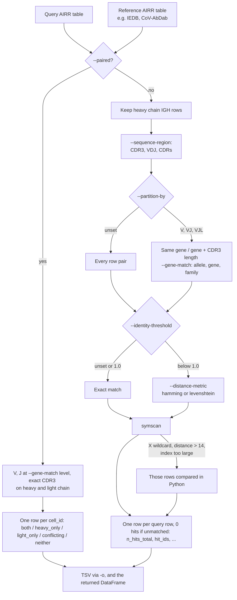

# Specificity annotations (work in progress)

Here we provide specificity annotation against public databases, currently
IEDB: download the reference table, convert it to AIRR, then match your own
receptors against it.

## IEDB: download and convert

[IEDB](https://www.iedb.org/) (`Iedb.py`) publishes BCR (antibody) receptor
sequences as a single table, `bcr`, inside a shared bulk ZIP export.

`bcr` downloads as a  schema-validated AIRR rearrangement TSV (plus a
`.validation.txt` report next to it).
The bulk export writes one file row per receptor, both chains side by side
under a two-row header (a category row over a field name row); each row
becomes one rearrangement record per chain it actually carries (one for a
single-chain submission, two for a paired one), linked by `cell_id`. Where
IEDB records a field twice, V/D/J-gene calls take the calculated value (IEDB's
IMGT standardized call, which it recommends for analysis) and CDRs the curated
one, each falling back to the other when it is blank.

```bash
# download and convert
immvoke specificity bcr --outdir tmp

# drop columns the AIRR schema does not define
immvoke specificity bcr --outdir tmp --strict-airr
```

## Annotating against it

`immvoke annotate` takes a query AIRR table and a reference one -- the
`tmp/specificity/bcr.tsv` written above -- and reports, for every query row,
which reference rows it matches. It is a thin wrapper over
`immvoke.Sources.Specificity.Annotate.annotateSpecificity()`, which takes
the same options (as file paths or DataFrames) and returns the result table.

The reference must always be an **AIRR rearrangement table**, whichever
database it comes from: every field the AIRR schema requires (`sequence_id`,
`sequence`, `rev_comp`, `productive`, `v_call`, `d_call`, `j_call`,
`sequence_alignment`, `germline_alignment`, `junction`, `junction_aa`,
`v_cigar`, `d_cigar`, `j_cigar`) present as a column, though values may be
blank. Any table immvoke writes as AIRR already is one; anything else is
refused with an error naming the missing fields. On top of that, each option
needs the AIRR fields it reads (`cdr3_aa`, `sequence_aa`, `cdr1_aa`/`cdr2_aa`,
`v_call`/`j_call`, `locus`, and `cell_id` for `--paired`). The query only needs
the fields it uses. Only heavy chain (`IGH`) rows are compared; a table with no
`IGH` rows left is an error, never an empty result.




| Option | Values | Meaning |
| --- | --- | --- |
| `--sequence-region` | `CDR3` (default), `VDJ`, `CDRs` | compare `cdr3_aa`; `sequence_aa` (full V(D)J); or `cdr1_aa`+`cdr2_aa`+`cdr3_aa` pooled under one shared tolerance |
| `--partition-by` | unset (default), `V`, `VJ`, `VJL` | only compare row pairs with the same V-gene; V- and J-gene; or V-gene, J-gene and CDR3 length |
| `--gene-match` | `allele`, `gene` (default), `family` | how `--partition-by` and `--paired` compare `v_call`/`j_call`; see below |
| `--identity-threshold` | unset (exact), or a fraction in (0, 1] | e.g. `0.9` allows up to floor(10% of the query's length) differences |
| `--distance-metric` | `hamming` (default), `levenshtein` | substitutions only, or substitutions/insertions/deletions (not with `CDRs`) |
| `--paired` | flag | V-gene, J-gene and exact CDR3 on *both* chains of the same reference antibody; see below |

Without `--paired`, only heavy chain (locus `IGH`) rows are compared on both
sides. `--partition-by` is off by default; an unpartitioned CDR3 comparison
at a loose threshold is prone to coincidental hits, especially on short
CDR3s, so `VJ` is usually what you want there.

### Gene names

`v_call`/`j_call` cells are not always one clean name: IEDB mixes allele
calls (`IGHV1-2*02`), gene calls (`IGHV1-2`), several calls in one cell
(`IGHV1-2*02, IGHV1-2*04`) and blanks. They are parsed with Change-O's gene
pattern and compared exactly at the `--gene-match` level:

| `--gene-match` | Agrees | Disagrees |
| --- | --- | --- |
| `allele` | `IGHV1-2*02` / `IGHV1-2*02`; `IGHV1-2*02` / `IGHV1-2` (allele unknown) | `IGHV1-2*02` / `IGHV1-2*04` |
| `gene` (default) | `IGHV1-2*02` / `IGHV1-2*04` / `IGHV1-2` | `IGHV1-2` / `IGHV1-69` |
| `family` | `IGHV1-2*02` / `IGHV1-69*01` | `IGHV1-2` / `IGHV3-23` |

A cell with several calls agrees if any one of them does. A blank or
unrecognized call is unknown and agrees with anything; the number of
unrecognized values is logged.

```bash
# exact CDR3 match, heavy chain
immvoke annotate --query mine.tsv --reference tmp/specificity/bcr.tsv \
    -o annotated.tsv

# exact full VDJ match within the same V- and J-gene
immvoke annotate --query mine.tsv --reference tmp/specificity/bcr.tsv \
    --sequence-region VDJ --partition-by VJ -o annotated.tsv

# same V+J gene, CDR3 at 85% amino acid identity (Hamming distance)
immvoke annotate --query mine.tsv --reference tmp/specificity/bcr.tsv \
    --partition-by VJ --identity-threshold 0.85 -o annotated.tsv

# as above, but the V and J alleles must agree too
immvoke annotate --query mine.tsv --reference tmp/specificity/bcr.tsv \
    --partition-by VJ --gene-match allele --identity-threshold 0.85 \
    -o annotated.tsv

# CDR1-3 pooled at 90% identity, same V-gene, J-gene and CDR3 length
immvoke annotate --query mine.tsv --reference tmp/specificity/bcr.tsv \
    --sequence-region CDRs --partition-by VJL --identity-threshold 0.9 \
    -o annotated.tsv

# CDR3 at 90% identity allowing insertions/deletions -- tolerates a query
# and reference CDR3 of different lengths, which hamming cannot at all
immvoke annotate --query mine.tsv --reference tmp/specificity/bcr.tsv \
    --partition-by VJ --identity-threshold 0.9 --distance-metric levenshtein \
    -o annotated.tsv
```

Every query row comes back with `n_hits_total`, `min_mismatches` (edit
distance under `levenshtein`, substitution count otherwise), `is_unique_hit`
and `hit_ids` (the reference `sequence_id`s). Hamming also adds
`mismatch_positions`, which Levenshtein can't produce since an indel shifts
every position after it. BLOSUM is not implemented.

### Paired heavy+light exact match

Without it, each chain row is matched on its own. `--paired` is stricter:
an antibody counts as a match only if the *same* reference antibody agrees
on V-gene and J-gene (at the `--gene-match` level) and exact CDR3 for both
its heavy and its light chain -- a heavy
hit on one reference antibody and an unrelated light hit on another doesn't
count. `--sequence-region`, `--partition-by`, `--identity-threshold` and
`--distance-metric` don't apply here; the columns (`cdr3_aa`, `v_call`,
`j_call`, `cell_id`, `locus`) are fixed by that definition.

```bash
immvoke annotate --query mine.tsv --reference tmp/specificity/bcr.tsv \
    --paired -o annotated.tsv
```

One row per query antibody (`cell_id`), classified as `both`, `heavy_only`,
`light_only`, `conflicting` (heavy and light each hit, but different
reference antibodies), or `neither`, alongside `heavy_hit_ids`,
`light_hit_ids` and `both_hit_ids` (their intersection).

### Backends

Every mode runs through [symscan](https://github.com/yutanagano/symscan), a
symmetric-deletion index that only ever looks at likely matches instead of
scoring every query x reference pair. symscan is a required dependency,
and there is no fallback to Python. A pure-Python engine gives the same
result and is kept for comparison, but only runs when chosen:

| `--backend` | Runs | Notes |
| --- | --- | --- |
| `symscan` (default) | every mode | `--threads -1` for every core |
| `python` | every mode | only when chosen; single threaded; cost grows with the candidate pool |

symscan has no concept of the `X` wildcard for an unresolved residue, so
under exact and Hamming matching the rows that carry one are compared in
Python instead, where `X` matches anything; every other row still goes
through symscan.

symscan indexes every deletion variant of every sequence -- a number that
grows steeply with the tolerance and the sequence length -- and aborts the
process above an edit distance of 14 or once that index outgrows memory.
`immvoke annotate` sizes each symscan call to stay within a fixed budget,
and compares whatever doesn't fit (a tolerance above 14, or very long
sequences at a high tolerance) in Python instead, with a warning. Because
that cost grows with the tolerance, a low threshold (e.g.
`--identity-threshold 0.7` on CDR3s) can run much faster with `--backend
python`, whose length bucketing and gene check don't depend on it; symscan's
advantage is at high thresholds on large tables.

Reference command: `immvoke specificity bcr --help`,
`immvoke annotate --help`.
