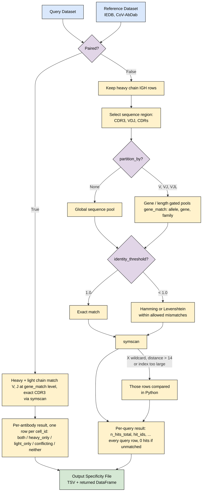

# Specificity annotation: idea

Match a query AIRR rearrangement table against a reference AIRR
rearrangement table (e.g. a downloaded specificity database such as IEDB's
BCR export) and report, for every query row, which reference rows it
matches. `immvoke annotate` on the command line and `annotateSpecificity()`
in Python (`immvoke.Sources.Specificity.Annotate`) both follow this flow.

## Input contract

The reference must always be an **AIRR rearrangement table**, whichever
database it comes from: every field the AIRR schema requires (`sequence_id`,
`sequence`, `rev_comp`, `productive`, `v_call`, `d_call`, `j_call`,
`sequence_alignment`, `germline_alignment`, `junction`, `junction_aa`,
`v_cigar`, `d_cigar`, `j_cigar`) present as a column, though values may be
blank. Any table immvoke writes as AIRR already is one; anything else is
refused with an error naming the missing fields. On top of that, each option
needs the AIRR fields it reads (`cdr3_aa`, `sequence_aa`, `cdr1_aa`/`cdr2_aa`,
`v_call`/`j_call`, `locus`, and `cell_id` for `--paired`). The query only needs
the fields it uses. Only heavy chain (`IGH`) rows are compared; a table with no
`IGH` rows left is an error, never an empty result.

Today only IEDB's `bcr` table is converted to AIRR; CoV-AbDab and ASD are
still downloaded in their own columns, so they cannot be used as a
reference until they are converted too.

## Workflow

## Options

| Step | `annotateSpecificity()` | `immvoke annotate` | Values |
| --- | --- | --- | --- |
| Paired? | `paired` | `--paired` | `False` (default), `True` |
| Sequence region | `sequence_region` | `--sequence-region` | `CDR3` (default), `VDJ`, `CDRs` |
| Partition | `partition_by` | `--partition-by` | `None` (default), `V`, `VJ`, `VJL` |
| Gene names | `gene_match` | `--gene-match` | `allele`, `gene` (default), `family` |
| Threshold | `identity_threshold` | `--identity-threshold` | `None`/`1.0` exact (default), or a fraction in (0, 1) |
| Metric | `distance_metric` | `--distance-metric` | `hamming` (default), `levenshtein` |
| Backend | `backend` | `--backend` | `symscan` (default, required), `python` (only when chosen) |
| Output | `output` | `-o/--out` | TSV path; the DataFrame is always returned |

## Notes

- **symscan is required** and runs every mode: exact, Hamming, Levenshtein
  and paired. It is a required dependency, so a normal install already has
  it. There is no install check and no fallback to the Python (rapidfuzz)
  engine.
- **Rows symscan cannot index** (an `X` wildcard, a distance above 14, or
  very long sequences at a high tolerance) are still compared in Python
  inside a symscan run, because symscan would crash on them.
- **`--backend python`** runs the pure-Python engine only when chosen
  explicitly, e.g. for comparison. It gives the same result.
- **Sequence regions:** `CDRs` pools `cdr1_aa`, `cdr2_aa` and `cdr3_aa` under
  one shared tolerance. That only works with Hamming distance, because edit
  distance does not pool across columns.
- **Partitions:** `VJL` gates on V-gene, J-gene and CDR3 length, and needs
  `cdr3_aa` in both tables whatever the sequence region is.
- **Gene names** (`v_call`, `j_call`) are parsed with Change-O's gene
  pattern, then compared exactly at the `gene_match` level:
  - `gene` (default): same gene, any allele. `IGHV1-2*02` = `IGHV1-2*04` =
    `IGHV1-2`, but `IGHV1-2` ≠ `IGHV1-69`.
  - `allele`: same gene and same allele. `IGHV1-2*02` ≠ `IGHV1-2*04`; a
    gene-level call such as `IGHV1-2` has an unknown allele and agrees with
    any allele of that gene.
  - `family`: same family. `IGHV1-2*02` = `IGHV1-69*01`.
  - A cell with several calls (`IGHV3-23*01, IGHV1-2*02`) agrees if any one
    of them agrees.
  - A blank or unrecognized call is **unknown and agrees with anything**.
- **Order of steps:** the Python backend checks genes first and only
  measures distance within agreeing pairs. symscan measures distance first
  and drops pairs whose genes disagree afterwards. The result is the same.
- **Paired mode** always requires V-gene and J-gene agreement (at the
  `gene_match` level) and an exact CDR3 on both chains of the same reference
  antibody; the region, partition and threshold options do not apply to
  it.
