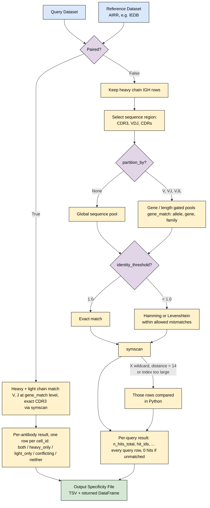

# Specificity annotation: how it works

`immvoke annotate` and `annotateSpecificity()` match a query AIRR table
against a reference AIRR table and report, for every query row, which
reference rows it matches. This page explains the flow and the rules behind
each step; [README.md](README.md) covers how to run it.

## Workflow

## Input contract

The reference must always be an **AIRR rearrangement table**, whichever
database it comes from: every field the AIRR schema requires (`sequence_id`,
`sequence`, `rev_comp`, `productive`, `v_call`, `d_call`, `j_call`,
`sequence_alignment`, `germline_alignment`, `junction`, `junction_aa`,
`v_cigar`, `d_cigar`, `j_cigar`) present as a column, though values may be
blank. Any table immvoke writes as AIRR already is one; anything else is
refused with an error naming the missing fields.

On top of that, each step reads its own AIRR fields: `cdr3_aa`,
`sequence_aa` or `cdr1_aa`/`cdr2_aa` for the sequence region, `v_call` and
`j_call` for partitions and paired matching, `locus` for the chain filter,
and `cell_id` to link the two chains of a paired antibody. The query only
needs the fields the chosen options read. A table without a `locus` column
is compared whole; a table with one but no `IGH` row left is an error, never
an empty result.

## Matching rules

**Sequence region.** `CDR3` compares `cdr3_aa`, `VDJ` compares
`sequence_aa`, and `CDRs` pools `cdr1_aa`, `cdr2_aa` and `cdr3_aa` under one
shared tolerance. Pooling only works with Hamming distance, because edit
distance does not add up across columns.

**Partition.** `V` and `VJ` only compare row pairs whose V-gene (and
J-gene) agree; `VJL` also requires the same CDR3 length, and so needs
`cdr3_aa` in both tables whatever the sequence region is.

**Gene names.** `v_call`/`j_call` cells are not always one clean name: IEDB
mixes allele calls (`IGHV1-2*02`), gene calls (`IGHV1-2`), several calls in
one cell (`IGHV1-2*02, IGHV1-2*04`) and blanks. They are parsed with
Change-O's gene pattern (`Genes.py`) and compared exactly at the
`gene_match` level:

| `gene_match` | Agrees | Disagrees |
| --- | --- | --- |
| `allele` | `IGHV1-2*02` / `IGHV1-2*02`; `IGHV1-2*02` / `IGHV1-2` (allele unknown) | `IGHV1-2*02` / `IGHV1-2*04` |
| `gene` (default) | `IGHV1-2*02` / `IGHV1-2*04` / `IGHV1-2` | `IGHV1-2` / `IGHV1-69` |
| `family` | `IGHV1-2*02` / `IGHV1-69*01` | `IGHV1-2` / `IGHV3-23` |

A cell with several calls agrees if any one of them does. A blank or
unrecognized call is **unknown and agrees with anything**; the number of
unrecognized values is logged.

**Threshold and metric.** An unset (or 1.0) `identity_threshold` is an
exact match. Below that, a query may differ from a hit by up to
floor((1 - threshold) x query length) positions: substitutions only under
`hamming`, or substitutions, insertions and deletions under `levenshtein`,
which also lets the two differ in length. Hamming reports which positions
differ; Levenshtein cannot, since an indel shifts every position after it.

**Paired.** An antibody is its heavy (`IGH`) and light (`IGK`/`IGL`) chain
rows sharing one `cell_id`. It matches a reference antibody only if that
*same* antibody agrees on V-gene and J-gene (at the `gene_match` level) and
exact CDR3 on both chains; a heavy hit on one reference antibody and a light
hit on another is `conflicting`, not `both`. Region, partition, threshold
and metric do not apply.

## Engine

- **symscan runs every mode.** It is a required dependency, a
  symmetric-deletion index that only looks at likely matches instead of
  scoring every query x reference pair. There is no install check and no
  fallback to the pure-Python engine.
- **Rows symscan cannot index are compared in Python** inside the same run:
  an `X` wildcard (it has no wildcard concept; in Python `X` matches
  anything under exact and Hamming matching), a distance above 14, or very
  long sequences at a high tolerance, since symscan aborts the process past
  those limits. Each symscan call is sized to stay within a fixed budget.
- **Order of steps.** symscan measures distance first and drops pairs whose
  genes disagree afterwards; the Python engine checks genes first and only
  measures distance within agreeing pairs. The result is the same.
- **`backend='python'`** runs the pure-Python engine only when chosen, e.g.
  for comparison. symscan's index grows with the tolerance, so at a low
  threshold (e.g. 0.7 on CDR3s) the Python engine can be faster; symscan's
  advantage is at high thresholds on large tables.

## Current limits

- Only IEDB's `bcr` table comes in AIRR so far (IEDB publishes it that
  way); CoV-AbDab and ASD are still downloaded in their own columns, so they
  cannot be used as a reference until they are converted.
- Antibodies only: TCR tables are not supported yet (no `IGH` rows, so they
  are refused).
- No substitution-matrix (BLOSUM) scoring.
